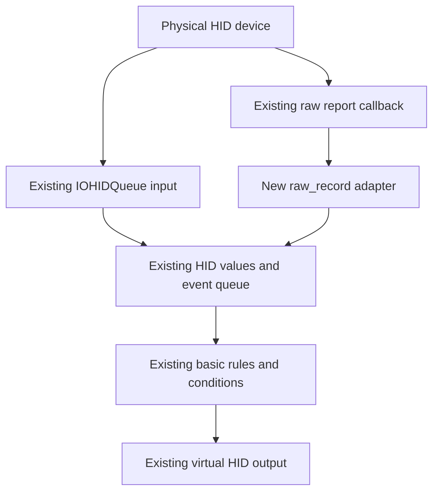

# Karabiner Raw Record MVP

English | [简体中文](README.zh-CN.md)

Adds `from.raw_record` to Karabiner-Elements so its existing rule engine can match raw HID input reports from a specific device. The first hardware-validated use case is **Bluetooth M5 remote Power → one F13 click**, without an additional system power action.

This experimental local-development fork is based on **Karabiner-Elements v16.3.0**. It provides separate `RawRecordMVP-Elements` and `RawRecordMVP-EventViewer` applications. They install alongside the official applications, switch between input engines through a helper, and reuse the installed official virtual HID driver.

## Input processing flow



The new adapter turns matching raw reports into inputs for the existing HID-value and event queue. Ordinary IOHIDQueue input continues through that queue as well. Both paths use the existing `basic` rules, `conditions`, and virtual HID output.

## Source and documentation

**Use the [feat/parallel-install-mvp](https://github.com/lznxbz/karabiner-raw-record-mvp/tree/feat/parallel-install-mvp) branch.** This README also appears on the repository homepage. `main` retains the upstream code; the MVP implementation, parallel-install tools, and documentation below live on the feature branch.

- [Parallel installation, switching, and complete validation record](https://github.com/lznxbz/karabiner-raw-record-mvp/blob/feat/parallel-install-mvp/docs/raw-record-parallel.md)
- [raw_record syntax and implementation](https://github.com/lznxbz/karabiner-raw-record-mvp/blob/feat/parallel-install-mvp/docs/raw-record-mvp.md)
- [Complete Bluetooth M5 rule example](https://github.com/lznxbz/karabiner-raw-record-mvp/blob/feat/parallel-install-mvp/examples/raw-record/m5-bluetooth.json)

## Validated results

Validation used an Apple Silicon Mac with macOS 27.2, Xcode 27.2, official Karabiner-Elements 16.3.0, and official virtual HID driver 1.8.0:

- **Nine physical Power operations produced exactly nine F13 down/up pairs.** Tests covered short presses, a two-second hold, Bluetooth disconnect/reconnect, Mac sleep/wake, and input after switching isolated profiles.
- In every phase, the user confirmed there was no additional sleep, shutdown, or power dialog. Holding the button did not produce extra clicks.
- Direction keys, Home, Back, List, and a rear-keyboard letter all showed input events. The test configuration adds only the Power → F13 mapping.
- After testing, the official backend, M5 grabbing, and previous service state were restored. **All 28 saved fingerprints matched** for official application files, driver helpers, service definitions, and configuration.
- Eight relevant C++ suites passed, totaling 2,488 assertions, including 83 raw-record assertions. Six profile-helper tests, 16 parallel-install/switch tests, and eight configuration/IPC namespace assertions also passed.
- Universal applications were built and their signatures verified. Physical validation covers only the Bluetooth device and local environment above.

USB operation, x86_64 hardware execution, forced-crash recovery, login/reboot, and switching profiles while a key is held have not been physically tested. The USB example's VID/PID comes from earlier protocol observations; verify the actual device before using it.

## Build and install

Prerequisites are official Karabiner-Elements **16.3.0** with its working virtual HID driver, full Xcode, Command Line Tools, XcodeGen, CMake, xz, Python 3, and Ruby.

Prepare a valid **Apple Development application-signing certificate** in Xcode and make sure its required Apple WWDR intermediate certificate is available. Replace the signing-identity placeholder below with your own valid application-signing identity.

```sh
git clone --branch feat/parallel-install-mvp https://github.com/lznxbz/karabiner-raw-record-mvp.git
cd karabiner-raw-record-mvp
git submodule update --init --recursive
security find-identity -v -p codesigning
export PQRS_ORG_CODE_SIGN_IDENTITY="YOUR_APPLICATION_SIGNING_IDENTITY_HASH"
bash scripts/raw-record/parallel/build.sh
```

The script builds the applications, runs checks, and creates `RawRecordMVP-Parallel.pkg` and `parallel-package.json`. It prints their output directory and **does not automatically install or switch services**.

The applications and helpers use the same development-signing identity. The outer installer package has no distribution signature: this is a local-development artifact, not a notarized distribution installer. An Apple Development application certificate cannot be used as an installer-distribution signing certificate.

Connect the Bluetooth M5, replace both paths below with your actual build-output paths, and run the parallel install helper:

```sh
python3 scripts/raw-record/parallel/install.py \
  /path/to/RawRecordMVP-Parallel.pkg \
  /path/to/parallel-package.json
```

Installation requests administrator authentication through the normal system process, verifies the package and signatures, and compares official file/configuration fingerprints. A first installation creates a separate Power → F13 profile; existing isolated configuration is preserved. See the [parallel installation guide](https://github.com/lznxbz/karabiner-raw-record-mvp/blob/feat/parallel-install-mvp/docs/raw-record-parallel.md) for the complete procedure.

## Switch and restore

After installation, open the isolated application and grant the required background-service, Accessibility, and Input Monitoring permissions to the components named **RawRecordMVP**:

```sh
python3 "/Library/Application Support/org.pqrs.rawmvp/RawRecordMVP-Elements/tools/raw-record-switch.py" setup
```

Activate the isolated version. The helper temporarily pauses the official input engine before starting the isolated engine; the shared virtual HID driver keeps running:

```sh
python3 "/Library/Application Support/org.pqrs.rawmvp/RawRecordMVP-Elements/tools/raw-record-switch.py" developer
```

Restore the official version when finished:

```sh
python3 "/Library/Application Support/org.pqrs.rawmvp/RawRecordMVP-Elements/tools/raw-record-switch.py" original
```

Run these commands as the logged-in user; macOS requests administrator authentication when needed. **Opening the isolated application alone does not activate the mapping.** Use the switch helper to activate it. If a previous switch was interrupted, run `original` to finish restoration before starting a new test.

Isolated configuration lives at `~/.config/karabiner-raw-record-mvp/karabiner.json`, or under `XDG_CONFIG_HOME` when set. The isolated version does not copy or rewrite official profiles. Before the first Power test on another device, save open work and confirm that the isolated engine has grabbed the target device.

## Rule example

This is a basic-manipulator fragment. `key_down` and `key_up` contain only the report payload, **excluding the Report ID**. The device, collection, report ID, and length must all match exactly.

```json
{
  "type": "basic",
  "from": {
    "raw_record": {
      "vendor_id": 25098,
      "product_id": 1031,
      "collection_usage_page": 1,
      "collection_usage": 128,
      "report_id": 3,
      "payload_length": 1,
      "key_down": [1],
      "key_up": [0]
    }
  },
  "to": [{ "key_code": "f13", "repeat": false }]
}
```

The Bluetooth M5 uses VID **25098**, PID **1031**, and System Control collection **0x01/0x80**. `repeat:false` emits one complete F13 click when pressed; the raw release report rearms the input for the next press.

`raw_record` is input-only; output continues to use ordinary `to` actions. It does not support wildcards, masks, or arbitrary raw HID output. Use it only for inputs the ordinary pipeline does not already translate. See the [syntax reference](https://github.com/lznxbz/karabiner-raw-record-mvp/blob/feat/parallel-install-mvp/docs/raw-record-mvp.md#json) for all field constraints.

## Test recording and upstream attribution

The isolated EventViewer has an F13 test-recording mode that is disabled by default. It records only F13 down/up events and their times. See the [verification guide](https://github.com/lznxbz/karabiner-raw-record-mvp/blob/feat/parallel-install-mvp/docs/raw-record-parallel.md#optional-f13-hardware-test-recorder) for activation and validation limits. Certificates, installer artifacts, local configuration, and keystroke logs are not published with the source.

This project is based on [pqrs-org/Karabiner-Elements](https://github.com/pqrs-org/Karabiner-Elements), retaining its history and [LICENSE.md](LICENSE.md). For the official application and general usage documentation, visit the [Karabiner-Elements website](https://karabiner-elements.pqrs.org/).
